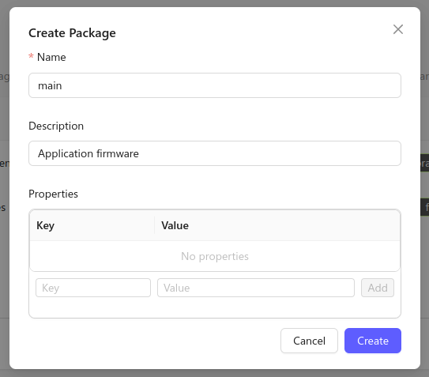
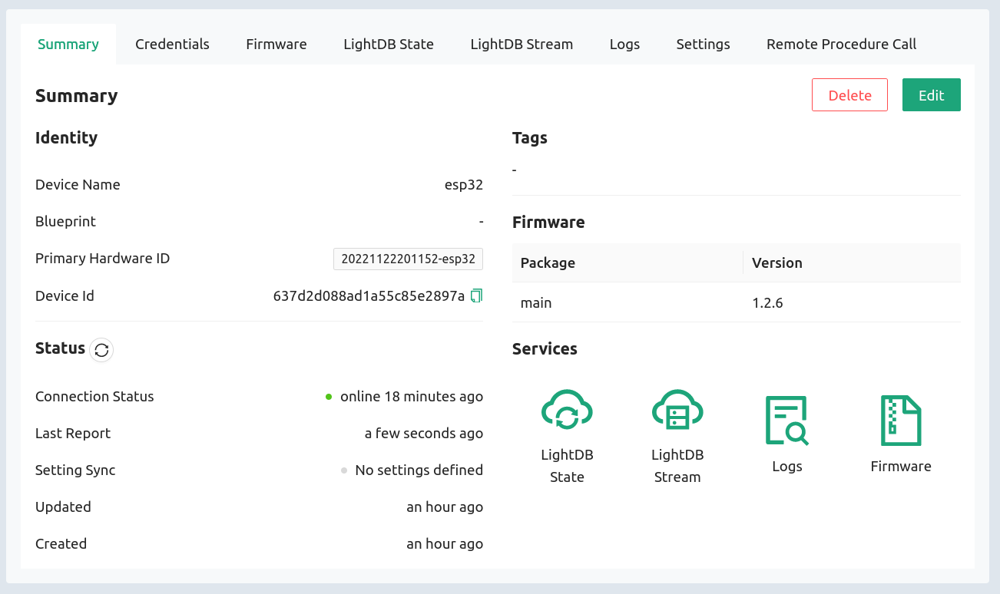

The most sought after Golioth feature is Over-the-Air firmware update (OTA). The
ability to update firmware is crucial to building a robust and reliable IoT
fleet. The Golioth Firmware SDK provides the OTA service, and the ESP-IDF
`fw_update` sample implements firmware updates on top of it. Let's try it out!

## Overview

On this page we'll cover the steps to completing an OTA update:

* Build and flash the initial `fw_update` firmware
* Change the version number in the sourcecode and build the binary
* Upload the binary to Golioth as a new Package
* Assign the device(s) to a Cohort
* Deploy the package to the device(s)

## Build and flash the initial firmware

Build the `fw_update` sample for the ESP32-S3 and flash it to the device:

```console
cd ~/golioth-firmware-sdk/examples/esp_idf/fw_update
idf.py set-target esp32s3
idf.py build flash monitor
```

Set the WiFi and Golioth credentials with the `settings set` commands from the
previous page, then type `reset`. The device reports firmware version `1.2.3`
to Golioth.

## Update version number and build firmware

Edit `golioth-firmware-sdk/examples/esp_idf/fw_update/main/app_main.c`,
updating the version number to `1.2.6`:

```c title="changes to: golioth-firmware-sdk/examples/esp_idf/fw_update/main/app_main.c"
static const char *_current_version = "1.2.6";
```

Now rebuild the example from the same
`golioth-firmware-sdk/examples/esp_idf/fw_update` folder.

```shell
idf.py build
```

:::tip Don't flash the ESP32!

Remember, do not use the `idf.py flash` command this time. We will be uploading
the new binary to the device over WiFi.

:::

After running the build command, your new binary will be located at
`build/fw_update.bin`.

## Upload the binary to Golioth and deploy it to your device

### 1. Create a Package

The Golioth Cloud represents upgradeable software components as "Packages". In
the OTA example code, the package for the application firmware is called "main",
so we'll need to create a corresponding package in the Golioth Console.

In the Golioth Console, go to **Firmware Updates&rarr;Packages** on the left
sidebar and click the Create button. Set the name of the package to `main`, and
optionally add a short description.



### 2. Upload the firmware binary

Now that we have created our package, we can upload the firmware binary as the
first version of `main`. Open the `main` package in the list of packages,
and click `New Version`.


* Set the **Artifact Version to 1.2.6** (to match what was compiled into the
  firmware)
* Click the upload button in the middle of the window and choose your
  `fw_update.bin` file.
* Click the **Upload Artifact** button to finish creating an artifact.

### 3. Assign the device to a Cohort

To enroll your device into Golioth's OTA update system, you need to assign it to
a Cohort. Cohorts are groups of devices that have the same firmware and receive
the same OTA updates.

First, we need to create a new Cohort for this device type. In the Golioth
Console, go to **Firmware Updates&rarr;Cohorts** in the left sidebar and click
the Create button. Select a name for your Cohort and click `Create`.

Next, we need to assign our device to this new Cohort. In the Cohort page, click
`Add Devices`, and find your device in the list. Click the Add button on the
right hand side of the device to assign it to the Cohort.


### 4. Create a deployment

OTA updates are rolled out to a Cohort as Deployments. To start a new update for
our device, go to the Cohort's page in the Golioth Console and click `Deploy`.
Add the `main` package to the deployment, and make sure it's set to version
1.2.6. You can optionally pick a name for your deployment.


Click `Next` to review your deployment, then `Start Deployment` to start the
update.

## Observe the OTA firmware update

In the terminal window you see the ESP32 almost immediately recognizes that new
firmware is available:

```console
I (31160) golioth_fw_update: Received OTA manifest
I (31160) golioth_fw_update: Current version = 1.2.3, Target version = 1.2.6
I (31160) golioth_fw_update: State = Downloading
I (31940) golioth_fw_update: Received block 0/921
I (31950) fw_update_esp_idf: Writing to partition subtype 17 at offset 0x1a0000
I (31950) fw_update_esp_idf: Erasing flash
W (34400) golioth_coap_client_libcoap: CoAP message retransmitted
I (36970) golioth_fw_update: Received block 1/921
I (37480) golioth_fw_update: Received block 2/921
I (38030) golioth_fw_update: Received block 3/921

...

I (243900) golioth_fw_update: Received block 919/921
I (244010) golioth_fw_update: Received block 920/921
I (244110) golioth_fw_update: Received block 921/921
I (244120) golioth_fw_update: Successfully downloaded 943248 bytes in 212390 ms
I (244120) esp_image: segment 0: paddr=001a0020 vaddr=3f400020 size=2efach (192428) map
I (244200) esp_image: segment 1: paddr=001cefd4 vaddr=3ffb0000 size=01044h (  4164)
I (244210) esp_image: segment 2: paddr=001d0020 vaddr=400d0020 size=9d4d4h (644308) map
I (244430) esp_image: segment 3: paddr=0026d4fc vaddr=3ffb1044 size=02dc0h ( 11712)
I (244440) esp_image: segment 4: paddr=002702c4 vaddr=40080000 size=161a0h ( 90528)
I (244480) golioth_fw_update: State = Downloaded
I (244680) golioth_fw_update: State = Updating
I (244780) fw_update_esp_idf: Setting boot partition
I (244780) esp_image: segment 0: paddr=001a0020 vaddr=3f400020 size=2efach (192428) map
I (244850) esp_image: segment 1: paddr=001cefd4 vaddr=3ffb0000 size=01044h (  4164)
I (244860) esp_image: segment 2: paddr=001d0020 vaddr=400d0020 size=9d4d4h (644308) map
I (245080) esp_image: segment 3: paddr=0026d4fc vaddr=3ffb1044 size=02dc0h ( 11712)
I (245090) esp_image: segment 4: paddr=002702c4 vaddr=40080000 size=161a0h ( 90528)
I (245160) golioth_fw_update: Rebooting into new image in 5 seconds
I (246170) golioth_fw_update: Rebooting into new image in 4 seconds
I (247170) golioth_fw_update: Rebooting into new image in 3 seconds
I (248170) golioth_fw_update: Rebooting into new image in 2 seconds
I (249170) golioth_fw_update: Rebooting into new image in 1 seconds

...

I (5262) esp_netif_handlers: sta ip: 192.168.200.7, mask: 255.255.255.0, gw: 192.168.200.1
I (5262) example_wifi: WiFi Connected. Got IP:192.168.200.7
I (5272) example_wifi: Connected to AP SSID: golioth
I (5282) golioth_mbox: Mbox created, bufsize: 2520, num_items: 20, item_size: 120
W (5282) fw_update: Waiting for connection to Golioth...
I (5312) golioth_coap_client_libcoap: Start CoAP session with host: coaps://coap.golioth.io
I (5322) golioth_coap_client_libcoap: Session PSK-ID: devboard-one-id@ttgo-demo
I (5332) libcoap: Setting PSK key

I (5342) golioth_coap_client_libcoap: Entering CoAP I/O loop
I (5632) golioth_coap_client_libcoap: Golioth CoAP client connected
I (5642) fw_update: Golioth client connected
W (5642) fw_update: Current FW Version: 1.2.6
I (5652) golioth_fw_update: Current firmware version: main - 1.2.6
I (5662) golioth_fw_update: Waiting for golioth client to connect before cancelling rollback
I (5662) golioth_fw_update: Firmware updated successfully!
```

1. The firmware will be downloaded in blocks
2. When the download is complete the ESP32 will reset automatically
3. After reset, the ESP32 will connect to Golioth and confirm it is running the
   most recent firmware version

## Confirm the new firmware version on the Golioth Console

After an OTA update, devices report their firmware version to Golioth.



Here you can see that the ESP32 is running the new version 1.2.6 firmware!
