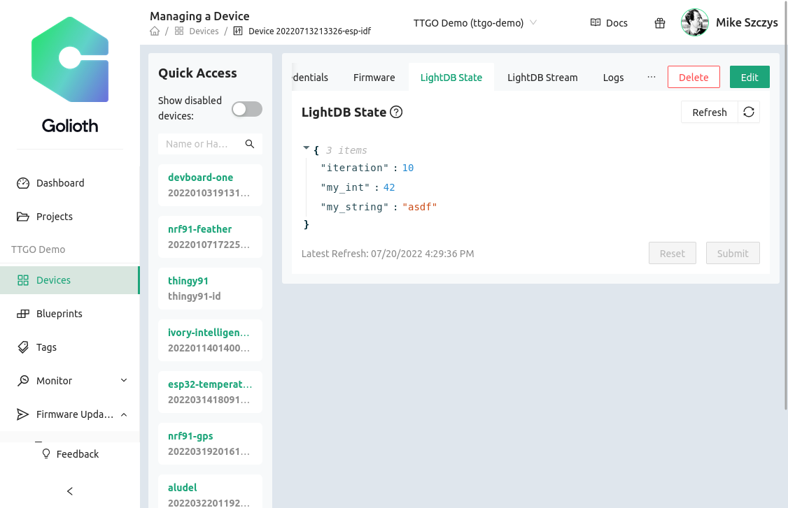
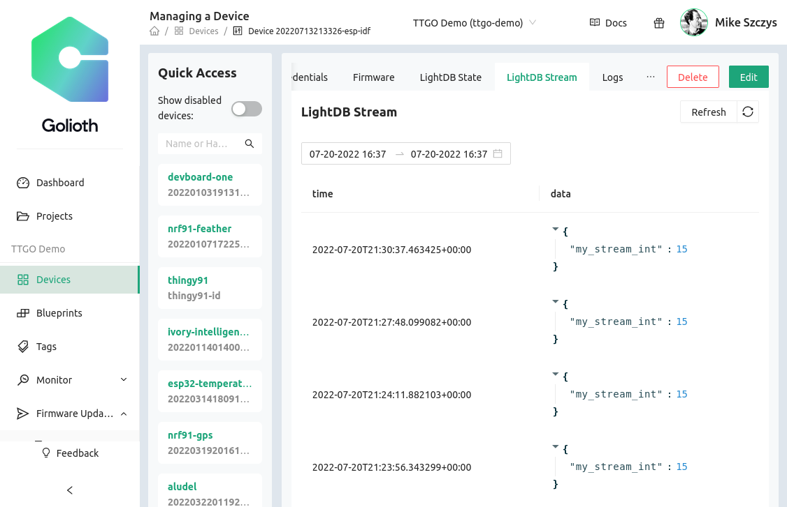
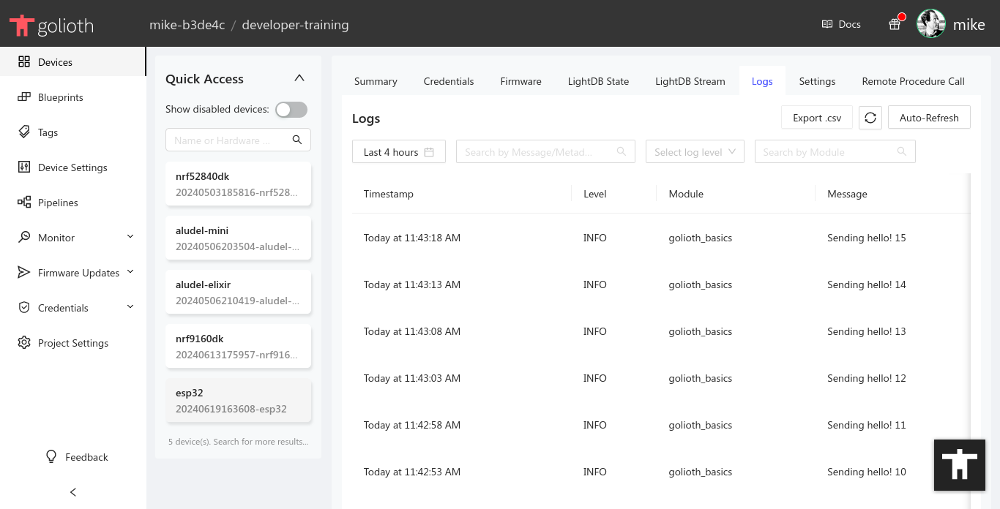

The ESP-IDF samples send different types of data to the Golioth Cloud. Included
are LightDB State (persistent data), Stream (time-series data routed by
Pipelines), and Log messages. All of these can be viewed from [the Golioth Web
Console](https://console.golioth.io).

### Viewing LightDB State data



State data shows the last updated value for each endpoint. The [`lightdb/set`
sample](https://github.com/golioth/golioth-firmware-sdk/tree/main/examples/esp_idf/lightdb/set)
updates the `counter` endpoint every 5 seconds; what is shown is the most
recent value of that counter.

```c
golioth_lightdb_set_int(client, "counter", counter, counter_set_handler, NULL);
```

Build the sample from the `golioth-firmware-sdk/examples/esp_idf/lightdb/set`
folder as described on the previous pages. Its README also explains how to
enable the LightDB State service (`CONFIG_GOLIOTH_LIGHTDB_STATE`) in
`idf.py menuconfig`.

### Viewing LightDB Stream data



Streaming data is routed by [Pipelines](/data-routing) on the Golioth Cloud. The
[`stream` sample](https://github.com/golioth/golioth-firmware-sdk/tree/main/examples/esp_idf/stream)
sends a CBOR-encoded temperature reading to the `data` path every 5 seconds.
The default Pipeline that every new project includes stores the data in
LightDB Stream, where the timestamp applied to each reading is visible in the
console.

```c
golioth_stream_set(client,
                   "data",
                   GOLIOTH_CONTENT_TYPE_CBOR,
                   buf,
                   payload_size,
                   temperature_push_handler,
                   NULL);
```

### Viewing Logs on the Golioth Web Console



The samples set `CONFIG_GOLIOTH_AUTO_LOG_TO_CLOUD=y`, so messages logged with
the `GLTH_LOGx` macros are also sent to Golioth. For example, the `hello`
sample sends this message every 5 seconds:

```c
GLTH_LOGI(TAG, "Sending hello! %d", counter);
```

:::note

Logs reach the Log tab through a [CBOR logs
Pipeline](/data-routing/examples/golioth-logs-cbor). New projects include it
by default; older projects need to add it.

:::

### Viewing Data with the `goliothctl` command line tool

It is also possible to view all of this data via the Golioth command line tools.
As an example, this command shows the last minute of logs:

```console
$ goliothctl logs --interval 1m
```

You can also filter logs. This command shows only `WARN` level logs and above
from the last five minutes:

```console
$ goliothctl logs --interval 5m --level WARN
```

The current value of the `counter` set by the `lightdb/set` sample can be
fetched with:

```console
$ goliothctl lightdb get <device-name> /counter
```
