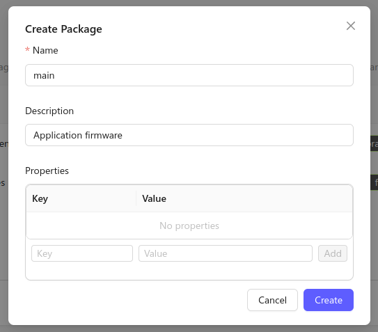
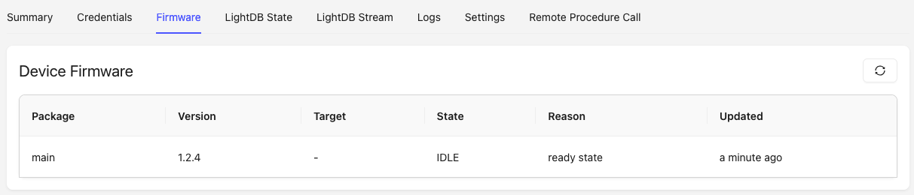

Over-the-Air (OTA) updates are a type of Device Firmware Upgrade (DFU). In this
page we'll walk through the FW Update sample found in [the Zephyr
port of the Golioth Firmware
SDK](https://github.com/golioth/golioth-firmware-sdk/tree/main/examples/zephyr/fw_update),
which shows how to use the Golioth OTA update service.

We will target the Nordic nRF9160 DK (using the NCS version of Zephyr), however
these step are portable to all other supported boards.

## Overview

### Expected Outcome

By the end of this page your device will download, verify, install, and run an
updated firmware version and report the results to the Golioth Console.

### OTA Update Sample Workflow

1. Build and flash the initial FW Update sample application
2. Set the device credentials
3. Upload the signed firmware as a new version of a Package
4. Assign the device to a Cohort and create a Deployment
5. Observe the device reporting the updated version number

## Running the OTA Sample

### 1. Initial build and flash

Navigate to the Golioth module in your zephyr install. This will be the
`modules/lib/golioth-firmware-sdk` directory of the west workspace.

```console
west build -b nrf9160dk/nrf9160/ns --sysbuild examples/zephyr/fw_update
west flash
```

By default, this will build and run firmware version `1.2.3` on the Nordic
nRF9160 development kit.

:::note Devices flashed with an earlier fw_update sample

Since Golioth Firmware SDK v0.23.0 the fw_update sample on the nRF9160 DK keeps
the MCUboot secondary slot in external flash. A device running a build of the
sample from an earlier SDK version must be reflashed with `west flash`, which
also programs MCUboot, instead of being updated over the air.

:::

### 2. Set device credentials

Open a serial terminal to the device and set the Golioth PSK-ID and PSK through
the shell. The credentials are stored using the Zephyr Settings subsystem:

```console
uart:~$ settings set golioth/psk-id <my-psk-id@my-project>
uart:~$ settings set golioth/psk <my-psk>
uart:~$ kernel reboot cold
```

:::tip Where do I find my device credentials?

Credentials can be copied from the Device details page in the [Golioth
Console](https://console.golioth.io).

:::

### 3. Rebuild firmware with new version number

Update the firmware version in the project `VERSION` file:

```cfg
VERSION_MAJOR = 1
VERSION_MINOR = 2
PATCHLEVEL = 4
```

Then build the application a second time.

```console
west build -b nrf9160dk/nrf9160/ns --sysbuild examples/zephyr/fw_update
```

:::note

Do not run the west flash command. We will upload this binary to the
Golioth Console and it will be loaded on the device via Over-The-Air (OTA)
update.

:::

### 4. Create a Package

The Golioth Cloud represents upgradeable software components as "Packages". In
the OTA sample code, the package for the application firmware is called "main",
so we'll need to create a corresponding package in the Golioth Console.

In the Golioth Console, go to **Firmware Updates&rarr;Packages** on the left
sidebar and click the Create button. Set the name of the package to `main`, and
optionally add a short description.



### 5. Upload the firmware binary

The binary we built is located at `build/fw_update/zephyr/zephyr.signed.bin`
and can now be used to create a new version of the `main` package on the
Golioth Console.

In the Golioth Console, go to **Firmware Updates&rarr;Packages** in the left
sidebar and open the `main` package in the list of packages, then click `New
Version`.


* Set the **Artifact Version to 1.2.4** (to match what was compiled into the
  firmware)
* Click the upload button in the middle of the window and choose your
  `zephyr.signed.bin` file
* Click the **Upload New Version** button to finish creating a new package
  version

### 6. Assign the device to a Cohort

To enroll your device into Golioth's OTA update system, you need to assign it to
a Cohort. Cohorts are groups of devices that have the same firmware and receive
the same OTA updates.

First, we need to create a new Cohort for this device type. In the Golioth
Console, go to **Firmware Updates&rarr;Cohorts** in the left sidebar and click
the `Create Cohort` button. Select a name for your Cohort and click `Create`.

Next, we need to assign our device to this new Cohort. In the Cohort page, click
`Add Devices`, and find your device in the list. Select the checkbox on the left
hand side of the device to assign it to the Cohort, then click the `Next` button.


In the following window, confirm the devices to be added to the Cohort by clicking
the `Add` button.


### 7. Create a deployment

OTA updates are rolled out to a Cohort as Deployments. To start a new update for
our device, go to the Cohort's page in the Golioth Console and click `Deploy`.
Add the `main` package to the deployment, and make sure it's set to version
`1.2.4`. You can optionally pick a name for your deployment.


Click `Next` to review your deployment, then `Start Deployment` to start the
update.

### 8. Verify the new version

By default, the device will use MCUboot to verify the signature of new firmware
and ensure that it can be run before switching. Once the new version is running,
the device will report the version to Golioth which can be viewed in the
Firmware tab of the Golioth Console.



## Summary

Over-the-Air updates are one of the most powerful tools in IoT. Running the
Golioth FW Update sample application has demonstrated how the firmware updates
are compiled and versioned, the process for creating the artifact and deployment
on the Golioth Console, and the device reporting back a new version number after
a successful update.

:::note Store credentials outside the application image

The FW Update sample stores the PSK credentials in the Zephyr Settings
subsystem, so a firmware update does not overwrite them. In production, store
per-device credentials (for example a device certificate) in persistent storage
that updates do not touch.

:::

:::note Binaries signed with a default key

This sample uses the default MCUboot key for signing. For production devices,
you must generate your own key to sign the binary files.

:::
